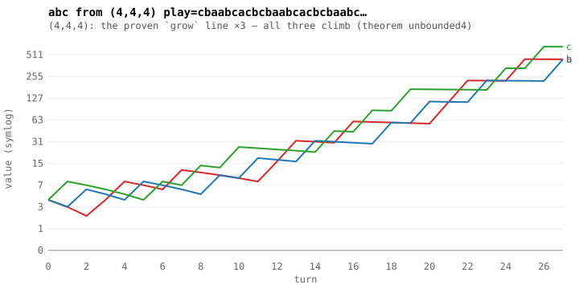
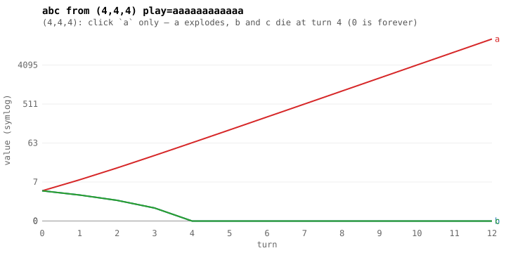
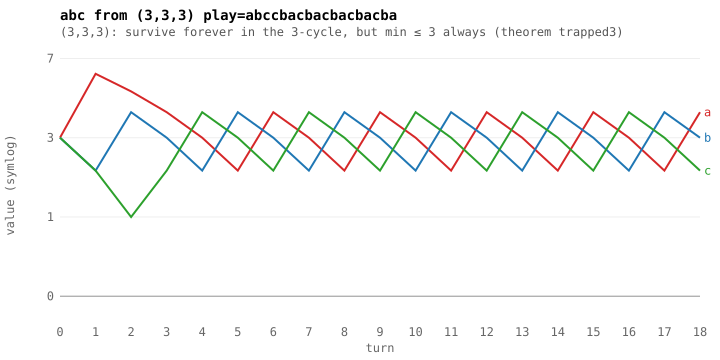
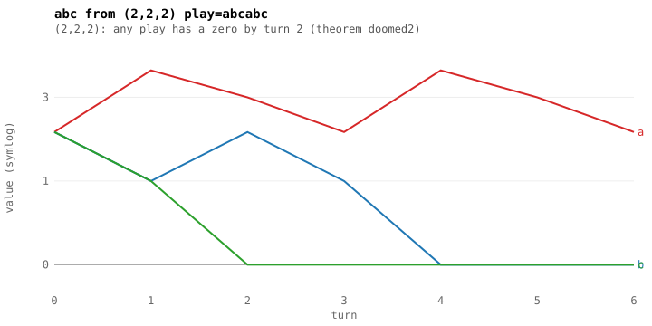
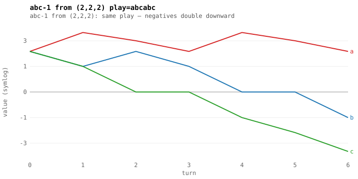
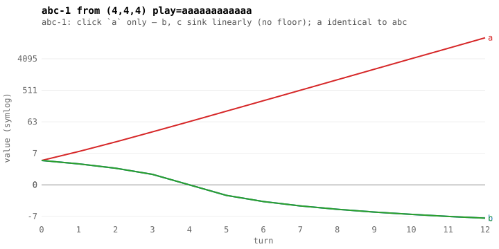
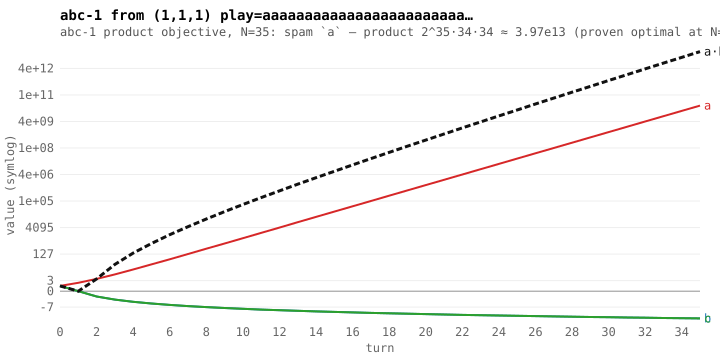
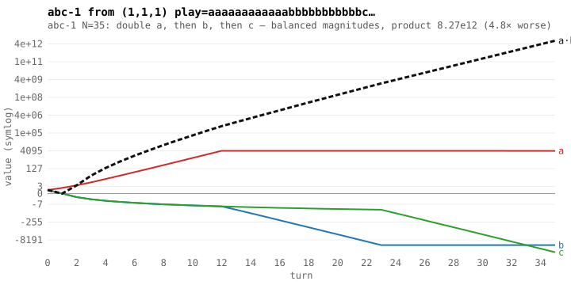
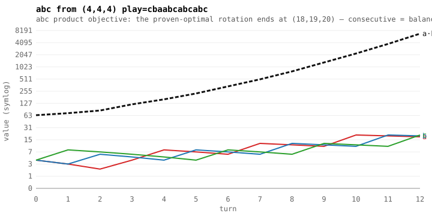

# plots — trajectories from the proven `step`

## grow
(4,4,4): the proven `grow` line ×3 — all three climb (theorem unbounded4)

final: a=442 b=442 c=661 min=442

## greedy
(4,4,4): click `a` only — a explodes, b and c die at turn 4 (0 is forever)

final: a=16384 b=0 c=0 min=0

## trapped
(3,3,3): survive forever in the 3-cycle, but min ≤ 3 always (theorem trapped3)

final: a=4 b=3 c=2 min=2

## doomed
(2,2,2): any play has a zero by turn 2 (theorem doomed2)

final: a=2 b=0 c=0 min=0

## doomed-nosat
abc-1 from (2,2,2): same play — negatives double downward

final: a=2 b=-1 c=-4 min=-4

## greedy-nosat
abc-1: click `a` only — b, c sink linearly (no floor); a identical to abc

final: a=16384 b=-8 c=-8 min=-8

## prod-spam35
abc-1 product objective, N=35: spam `a` — product 2^35·34·34 ≈ 3.97e13 (proven optimal at N=9; witness at 35)

final: a=34359738368 b=-34 c=-34 min=-34

## prod-split35
abc-1 N=35: double a, then b, then c — balanced magnitudes, product 8.27e12 (4.8× worse)

final: a=4073 b=-22540 c=-90112 min=-90112

## prod-balanced
abc product objective: the proven-optimal rotation ends at (18,19,20) — consecutive = balanced

final: a=18 b=19 c=20 min=18
